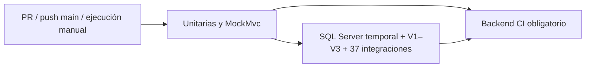

# Fase 12.10 — Integración continua del backend

## Estado de la entrega

El workflow completo está en [backend-ci.yml](../.github/workflows/backend-ci.yml).

**Validado localmente:** compilación y 153 pruebas Java sin SQL, ejecutadas con Java 21 mediante el nuevo script Bash; 16 pruebas Python de los controles; validación estática con actionlint 1.7.12; sintaxis de los scripts Bash. No hubo fallos ni pruebas Java omitidas.

**Pendiente:** ejecutar el workflow en GitHub y comprobar las 37 integraciones dentro del contenedor. Docker Desktop está instalado, pero su motor no estaba iniciado en este entorno Windows. No se inició Docker ni se ejecutaron las integraciones contra las bases locales. Las 37 pruebas SQL de la fase 12.9 son evidencia histórica, no una ejecución de esta fase.

La carpeta recibida no contiene `.git`, remotos ni workflows anteriores. No se inicializó Git, no se hizo push y no se modificaron ajustes externos de GitHub.

## Arquitectura



| Job | Ejecución |
|---|---|
| `unit` | Checkout sin credenciales persistidas, Temurin 21, caché Maven, controles Python, compilación y pruebas mediante Maven Wrapper. Verifica el contrato JUnit y publica resultados saneados. |
| `sqlserver` | Se inicia después de aprobar `unit`. Crea un contenedor SQL Server, prepara una base vacía con Flyway, utiliza una cuenta de pruebas y ejecuta la suite SQL real. Comprueba las tres carreras de refresh y descarta el contenedor. |
| `ci` | Check estable **Backend CI obligatorio**. Se ejecuta con `always()` y exige que ambos jobs anteriores tengan resultado `success`. Un job omitido, fallido o cancelado impide aprobar este check. |

Disparadores: todos los pull requests, push a `main` y `workflow_dispatch`. Se asumió `main` como rama principal porque no existe información Git local; si el repositorio utiliza otro nombre, cambiar `on.push.branches`. No se utilizan filtros de rutas que puedan omitir accidentalmente los controles.

Los jobs utilizan runners `ubuntu-24.04` hospedados por GitHub. Hay límites de tiempo y cancelación de ejecuciones anteriores de la misma rama o PR. La limpieza se solicita con `always()`; si GitHub termina por la fuerza una VM, su entorno efímero tampoco conserva la base porque no hay volúmenes externos.

## Reutilización y requisitos

- Maven Wrapper **3.10.0**, perfiles del POM y dependencias existentes. No se modificó `pom.xml`.
- Java **21** mediante `actions/setup-java`; las acciones oficiales están fijadas a SHA de commit. Sus versiones consultadas fueron checkout 7.0.1, setup-java 6.1.0 y upload-artifact 7.0.2, con runtime Node 24.
- Bash, Python 3 con biblioteca estándar, OpenSSL y Docker en el runner Linux. No se requieren paquetes Python externos.
- SQL Server **2025, Linux amd64**, alineado con la versión 17 observada en la fase anterior. Imagen oficial:

```text
mcr.microsoft.com/mssql/server:2025-latest@sha256:245f6b1c8903edae52cb20fa31419cefcde1a49938bb8c3447099011fc871ca3
```

El digest fija el contenido aunque cambie la etiqueta `2025-latest`. Se comprobó en MCR que la imagen es Linux amd64, utiliza el usuario `mssql` y no declara volúmenes. Esa consulta no equivale a arrancar el contenedor. El job reserva 3 GiB y dos CPU para el contenedor; configura 2048 MiB como límite de memoria de SQL Server.

El script PowerShell existente se conserva para su uso en Windows. CI utiliza scripts Bash independientes y el wrapper `mvnw`, por lo que no presupone que `java.exe` o `mvnw.cmd` existan en Linux. `.gitattributes` exige LF para el wrapper, scripts shell y workflows; no se necesita conservar el bit ejecutable porque se invocan con `bash`.

## Aislamiento de SQL Server

1. Se generan dos contraseñas aleatorias diferentes y una marca de ejecución mediante OpenSSL. Se registran las contraseñas como valores enmascarados antes de utilizarlas.
2. Se crea un contenedor único `lmmedical-ci-<run_id>-<attempt>`, con hostname `lmmedical-ci` y etiqueta de propiedad. No se admiten motores Docker remotos, runners autohospedados, red host ni montajes persistentes.
3. Docker publica SQL Server únicamente en `127.0.0.1`, mediante un puerto aleatorio. El puerto **1433 del host está prohibido**.
4. Se comprueba que el puerto y la etiqueta pertenecen al contenedor de esta ejecución. La disponibilidad se verifica con `sqlcmd` dentro del contenedor, con reintentos limitados.
5. Se crea una base nueva llamada **`LM_Medical_Test` dentro del contenedor**, con una propiedad extendida que contiene la marca de ejecución. El nombre respeta las protecciones existentes del perfil `test`; no se refiere a la base homónima del desarrollador.
6. El plugin Flyway existente ejecuta `migrate` y `validate`, con `target=3`, `baselineOnMigrate=false` y `cleanDisabled=true`. La cuenta administrativa efímera se usa solo para preparar esta instancia. No se modifica V1, V2 ni V3.
7. Se verifican exactamente tres migraciones SQL correctas y las 15 tablas esperadas. Se crea `lm_ci_test`, con `db_datareader`, `db_datawriter` y `VIEW DEFINITION` únicamente en esta base. Las pruebas no utilizan `sa` y no reciben su contraseña en el proceso Maven.
8. `CiSqlServer` reemplaza el destino de la prueba mediante `DynamicPropertySource`. Construye la URL exclusivamente con loopback, puerto validado y nombre fijo; no acepta una URL externa. En GitHub, la ausencia de configuración CI provoca un fallo en vez de recurrir a `localhost:1433`.
9. Antes de escribir, se mantienen los controles `DB_NAME()` existentes y se comprueban la marca de la base y el nombre del servidor. Flyway automático, bootstrap e inicialización SQL permanecen desactivados en la aplicación de pruebas; Hibernate utiliza `validate`.
10. `cleanup` elimina exclusivamente el contenedor que conserva la etiqueta de esta ejecución, incluso si está detenido. No ejecuta `DROP DATABASE`, `flyway:clean` ni limpieza en instancias externas.

Los 37 escenarios siguen utilizando JPA, transacciones, bloqueos y SQL Server reales. La adaptación de CI no sustituye repositorios ni simula las carreras.

### Variables

No hay secretos de desarrollo o producción que deban registrarse en GitHub para este workflow.

| Variable | Origen y uso |
|---|---|
| `GITHUB_ACTIONS`, `RUNNER_ENVIRONMENT`, `GITHUB_RUN_ID`, `GITHUB_RUN_ATTEMPT` | Valores proporcionados por GitHub; se comprueba que el runner sea hospedado. |
| `CI_SQLSERVER_CONTAINER` | Nombre del contenedor de esta ejecución. |
| `CI_SQLSERVER_PORT` | Puerto aleatorio confirmado mediante Docker inspect. |
| `CI_SQLSERVER_MARKER` | Identidad aleatoria de esta base y este contenedor. |
| `MSSQL_SA_PASSWORD` | Credencial efímera exclusiva de preparación; nunca se escribe en el repositorio ni en argumentos Maven. |
| `DB_USERNAME`, `DB_PASSWORD` | Cuenta efímera de pruebas creada dentro del contenedor. |
| Clave JWT | La suite SQL genera su propia clave temporal. No se utiliza `JWT_SECRET_BASE64` del desarrollador. |

`GITHUB_TOKEN` tiene únicamente `contents: read`, no se persiste en Git y se retira del entorno del proceso Maven de tests. Las contraseñas no aparecen en argumentos `-P` de sqlcmd; se entregan mediante su entorno. Las conexiones JDBC no incluyen contraseñas.

## Barrera contra falsos positivos

`scripts/ci/test-plan.json` conserva los identificadores de los casos requeridos:

- **153** unitarias y MockMvc: las 139 anteriores y 14 pruebas nuevas de protección del destino CI.
- **37** integraciones, incluidas las repeticiones `[1]`, `[2]` y `[3]` de la carrera de refresh.

Las pruebas adicionales pueden incorporarse sin bloquear el pipeline. La ausencia de un caso requerido sí falla, aunque otro caso mantenga el mismo conteo total. El contrato no se regenera automáticamente en GitHub.

Antes de ejecutar Maven se eliminan solo los XML generados de la suite y se registra el inicio. Después se exige:

- Código de salida Maven igual a cero.
- Informes presentes, válidos y posteriores al inicio de esta ejecución.
- Conteos consistentes con los casos contenidos en el XML.
- Cero fallos, errores o casos omitidos.
- Ausencia de duplicados y presencia de todos los casos obligatorios.
- Las tres repeticiones de concurrencia en la suite SQL.

Por tanto, `skipTests`, un perfil que no seleccione integraciones, un fallo de `BeforeAll`, SQL Server no disponible o una migración fallida no pueden producir un resultado válido. Las 16 pruebas de las herramientas incluyen estos controles y la retirada de datos sensibles de los informes.

## Reportes y diagnóstico

| Ubicación | Tratamiento |
|---|---|
| `target/security-phase129/unit/` y `sqlserver/` | JUnit original, reutilizando el POM. No se sube directamente a GitHub. |
| `target/ci-private/` | Estado de ejecución, salida Java, código Maven y log Maven original. No se publica. |
| `$RUNNER_TEMP/lmmedical-ci-private/` | Logs privados de preparación SQL y Flyway. No se publican. |
| `target/ci-reports/<suite>/TEST-*.xml` | XML reconstruidos con nombres, duraciones y estados; sin propiedades, logs, mensajes ni stacks originales. |
| `target/ci-reports/<suite>/summary.json` | Resultado Maven, conteos, problemas de ejecución y casos ausentes o fallidos. |

Los únicos artefactos publicados son los XML saneados y `summary.json`, mediante una lista explícita de archivos. Se conservan siete días y se intentan publicar también cuando falla el job. Los logs crudos quedan en la VM efímera y se descartan al finalizar; para obtener detalles completos debe reproducirse el comando localmente en un entorno autorizado.

## Comandos

Linux o Bash con Java 21:

```bash
python3 -m unittest discover -s scripts/ci/tests -v
bash scripts/ci/run-tests.sh unit
python3 scripts/ci/reports.py verify unit
```

Windows conserva la ejecución ya existente:

```powershell
.\scripts\test\Invoke-SecurityTests.ps1 -JavaHome 'C:\ruta\al\jdk-21'
python -m unittest discover -s scripts/ci/tests -v
```

La validación local de esta entrega también ejecutó `run-tests.sh unit` con Git Bash, `JAVA_HOME` de Java 21 y `PYTHON_BIN=python`. No utiliza Docker ni credenciales SQL.

La suite SQL de CI se reproduce mediante **Actions → Backend CI → Run workflow** una vez publicado el repositorio. Los scripts SQL CI bloquean deliberadamente su ejecución fuera de un runner Linux hospedado por GitHub; no se deben eludir esas comprobaciones apuntándolos a bases del desarrollador.

### Errores frecuentes

| Síntoma | Comprobación |
|---|---|
| No aparece una ejecución | Revisar que Actions esté habilitado, que el workflow esté publicado y que la rama principal sea `main`. El primer PR desde un fork puede requerir aprobación de GitHub. |
| Job Maven falla | Revisar `summary.json` y los identificadores de casos; reproducir el comando local. Una resolución de dependencias fallida también devuelve Maven no cero. |
| `required_cases_missing` o `test_count_below_contract` | Revisar selección Surefire, anotaciones que omiten tests y cambios de nombres. No reducir el contrato para ocultar un fallo. |
| `concurrency_cases_missing` | Deben ejecutarse las tres repeticiones reales. No reemplazarlas por mocks ni casos de relleno. |
| `invalid_or_stale_junit_report` | Revisar que se usen `prepare` y Maven antes de `verify`, sin `clean` intermedio que borre el estado privado. |
| SQL no disponible | Revisar disponibilidad del runner, descarga de MCR, recursos y ruta sqlcmd. El job falla y solicita limpieza; no debe cambiarse la URL por una base local. |
| Flyway o Hibernate rechazan el esquema | Revisar las migraciones y el target autorizado en un entorno temporal. No modificar migraciones históricas ni activar baseline automático. |
| Imagen o acción deja de estar disponible | Actualizar el digest o SHA después de comprobar la fuente oficial y revisar el cambio. No sustituirlo por una etiqueta mutable sin fijación. |
| `Backend CI obligatorio` falla con otro job omitido | Resolver el fallo que impidió ejecutar esa suite. El check final exige ambas. |

## Agregar pruebas o migraciones

1. Añadir pruebas unitarias siguiendo las convenciones actuales de Surefire. Para SQL, extender la clase protegida o incluir explícitamente nuevas clases en el perfil `security-sqlserver`, conservando los controles de destino CI.
2. Ejecutar los casos y revisar sus identificadores JUnit. Incorporar los casos nuevos a `test-plan.json` y elevar el mínimo correspondiente cuando pasen. Un cambio intencionado de nombre requiere actualizar el identificador con revisión.
3. Mantener los tres casos de concurrencia y evitar omisiones condicionadas que conviertan un fallo de entorno en un test verde.
4. Una futura V4 requiere revisar el target, las comprobaciones de historial y el esquema esperado del job temporal. No ejecutar V4 en bases externas ni reescribir V1–V3 como parte de esa actualización.

## Archivos de esta entrega

**Creados:** `.github/workflows/backend-ci.yml`, `.gitattributes`, `scripts/ci/run-tests.sh`, `sqlserver.sh`, `container_target.py`, `reports.py`, `test-plan.json`, `scripts/ci/tests/test_ci_tools.py`, `src/test/java/com/lmmedical/inventory/support/CiSqlServer.java`, `CiSqlServerTest.java` y este documento.

**Modificados:** `SecuritySqlServerTest.java` para configurar y verificar el destino CI; `.gitignore` para ignorar cachés Python. El POM, el script PowerShell, el wrapper y sus propiedades, los perfiles de aplicación, las clases productivas y V1–V3 conservan sus contenidos.

## Pendientes externos

1. Publicar los archivos en el repositorio GitHub cuando su propietario lo autorice. Esta entrega no realizó push.
2. Habilitar Actions si la organización lo restringe y ejecutar el workflow manualmente.
3. Confirmar el primer resultado real del contenedor, Flyway y las 37 integraciones. Hasta entonces no se declara que GitHub Actions haya funcionado.
4. Configurar un ruleset o protección de `main` que exija **Backend CI obligatorio**, antes de permitir merges. El workflow preparado no cambia por sí solo esa configuración del repositorio.

Durante esta fase no se utilizaron credenciales de desarrollo ni se realizaron conexiones o escrituras a `LM_Medical_supplies` o a la `LM_Medical_Test` local. Las comprobaciones por hash confirmaron que los archivos productivos y las migraciones históricas no cambiaron.

## Referencias consultadas

- [Seguridad de GitHub Actions](https://docs.github.com/en/actions/reference/security/secure-use): permisos mínimos, enmascarado y fijación de acciones a commits.
- [Variables de GitHub Actions](https://docs.github.com/en/actions/reference/workflows-and-actions/variables): variables del runner y diferenciación entre hospedado y autohospedado.
- [SQL Server en contenedores Linux](https://learn.microsoft.com/en-us/sql/linux/install-upgrade/quickstart-install-docker?view=sql-server-ver17): plataforma amd64, herramientas sqlcmd y ciclo de vida del contenedor.
